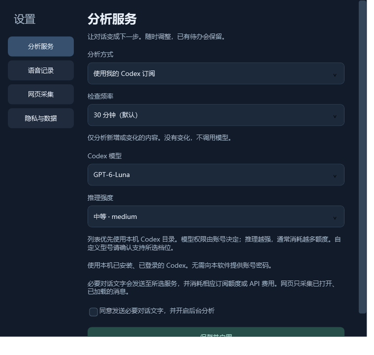

# 对话待办 · Conversation Todo

[简体中文](README.md) · [English](README.en.md)

一个运行在 Windows 桌面的悬浮组件：被动读取支持的 AI 对话，提取接下来要做的事，再按优先级展示。你不用把每个任务手动复制进待办列表。

**本项目的应用代码、界面、打包配置和文档全部由 AI 生成并迭代，包括你正在阅读的说明。作者提出产品想法、需求和反馈。Node.js、Inno Setup 等第三方工具由各自作者开发，不属于本项目的 AI 创作声明。**

当前只发布**中国大陆预览版**，界面为简体中文。英文说明不代表另有海外发行版。

## 下载与安装

到 [GitHub Releases](https://github.com/Jarawlith/conversation-todo/releases) 下载 `ConversationTodo-Mainland-Setup-0.7.4.exe`，双击安装。安装包包含 Node.js 运行环境，无需另装 Node.js 或手动运行脚本；不要求管理员权限。支持 Windows 10 / 11 x64。

安装时可选择桌面快捷方式和开机启动。首次启动，请在设置里选择分析方式，并同意将必要的对话文字发送至所选服务。关闭窗口会收起到托盘继续运行；右键托盘可以退出。

预览安装包尚未进行代码签名，Windows 可能显示“未知发布者”。在 Windows 应用列表中可卸载；个人待办、设置和加密密钥会保留在 `%LOCALAPPDATA%\CodexTodo`。

## 功能

- 被动扫描本机 Codex 和 Claude Code 保留的会话；内部代理消息、思考和工具输出不进入分析。
- 通过 Chrome 扩展采集已打开、已加载的 ChatGPT / Claude 网页聊天。不会自动滚动，不读取未打开的云端历史。
- 用户明确承诺的事项进入待办；AI 建议进入“待确认”，由用户决定是否加入。
- 按优先级排序，默认显示前三项，其余点击展开。可手动完成、忽略、调优先级、恢复和查看原文依据。
- 对话明确表示完成或取消时，自动更新任务并保留记录。同一件事在不同对话里分别保留来源，不自动跨对话合并。
- 可暂停，也可排除对话。排除会停止采集分析，并删除已有派生任务及本机采集的网页文字，不修改原始对话日志。
- 深色、可拖动、可折叠、可置顶的桌面组件，支持托盘和开机启动。

## 分析方式与要求

| 设置 | 要求与费用 |
| --- | --- |
| 使用我的 Codex 订阅 | 本机已有官方 Codex 工具并完成登录，使用账户可用的模型。模型可从下拉列表选择，优先读取本机 Codex 目录；推理强度可按模型支持范围选择低、中、高及更高档位。默认 `gpt-6-luna`、中等推理；不是仅登录 ChatGPT 网页就能使用。调用消耗你的账户额度。 |
| 使用我的 Claude 订阅 | 本机已有官方 Claude Code 并完成登录。默认 `haiku`；下拉列表提供 Haiku、Sonnet、Opus、Fable 和具体版本，也保留自定义型号及安装路径。Fable 可能使用额外付费额度。调用消耗你的账户额度。 |
| 使用软件提供的 AI | **公共服务尚未开放。GitHub 下载者当前不能使用作者的 API 额度。** 未来接入时，服务地址由软件预置，用户不填写后台地址。 |
| 使用我的 API Key | 自行填写接口地址、模型 ID 和自己的密钥。支持 OpenAI 兼容接口（如 DeepSeek、豆包等）与 Anthropic 原生协议；实际协议兼容性、可用模型和网络由供应商决定，并非所有供应商都已实测。费用由你承担。 |

本软件不收集你的 ChatGPT / Claude 账号密码，也不代替你购买订阅或完成官方工具登录。使用自己的订阅或 API 不会消耗作者的 OpenRouter 额度。

### Chrome 网页采集：只需设置一次

本机日志采集不需要扩展。网页采集请在设置展开“开启 Chrome 网页采集”，点击“打开 Chrome 并复制扩展路径”，然后：

1. 在 `chrome://extensions` 开启开发者模式。
2. 点击“加载已解压的扩展程序”，粘贴软件复制的文件夹路径。
3. 刷新打开的 ChatGPT / Claude 聊天页面。

扩展尚未上架 Chrome Web Store。普通 Windows 上的 Chrome 不允许静默安装未上架扩展，因此安装 EXE 不能自动完成这一确认步骤。[Chrome 官方说明](https://developer.chrome.com/docs/extensions/how-to/distribute/install-extensions)

### 检查频率与 Token

默认每 **30 分钟**检查，可选 5、15、30、60 分钟或每天一次。检查文件变化不会调用模型；仅有待分析的新增或修改消息才会发起调用。首次启用会自动连续分批分析所有可读取且未排除的历史对话，直到完成，无需等待下一次定时检查；可以暂停，失败后按已保存的断点继续。首次分析会消耗额度。网页历史仍限于已加载的内容。

程序记录消息指纹和分批进度，只发送变化消息、少量上下文及已有任务简表。不同对话分别分析，不把全部历史每次重新上传。网络或服务失败不自动重试，也不自动换用其他模型。会话编号或原文引用校验失败时，仅对该对话额外修正一次（会消耗额度）；仍失败则保留断点，并继续其他对话。空白和全角字符差异可匹配回真实原文；改写或拼接的引用不接收。

## 内置服务的成本限制

当前大陆版内置服务固定为 **DeepSeek V4 Flash 0731**：`deepseek/deepseek-v4-flash-0731`。设置页只列出该型号，后台也拒绝大陆账户请求其他型号。限制针对作者付费的内置服务；用户自备订阅和密钥不受此型号限制。

2026-10-10 查询 [OpenRouter 实时目录](https://openrouter.ai/api/v1/models) 时，该型号具有当时 DeepSeek 文本型号中最低的目录输入报价，但目录最低价路由不满足本程序的 JSON 参数要求。进一步查询 [供应商端点目录](https://openrouter.ai/api/v1/models/deepseek/deepseek-v4-flash-0731/endpoints)，最低的参数兼容端点报价为 **$0.00869 / 百万输入 token**、**$0.27 / 百万输出 token**，并已通过一次真实合成请求。它适合本项目输入多、输出少的分析方式；并非所有输入／输出比例下都最便宜，也不保证价格长期不变。

后台按价格排序路由，并设置上述输入、输出单价上限；没有符合条件的供应商时请求失败，不自动接受更贵的路由。可选推理关闭。每账户日请求数、输入字符数和并发也有限制，但这些**不等于整个账户的美元消费上限**。正式开放前仍需要安全的身份发放、全局预算和公开 HTTPS 服务；作者应另在 OpenRouter 为服务密钥设消费上限。见 [后台部署说明](docs/DEPLOYMENT.md)。

## 隐私与已知限制

对话读取在本机进行，**分析会向所选云端供应商发送必要文字**。选择 OpenRouter 时，OpenRouter 和实际模型供应商会收到文字；“大陆版”不保证数据只在中国境内处理。网页采集不读取密码、Cookie 或未打开的聊天。

密钥和客户端访问令牌由当前 Windows 用户的 DPAPI 加密保存。安装包与公开源码不包含作者的 API Key、服务器登录信息、私人对话或个人任务。后台只持久化用量计数，不保存对话正文。

这是早期预览版，AI 可能误判、遗漏或错误排序；请查看原文依据再确认重要事项。较长日志和网页会截断，网页未加载历史不会被采集，原始格式与网页布局变化也可能影响读取。Chrome 真实页面采集、各供应商端到端兼容性与其他电脑安装仍需要更多实测。

## 源码、构建与反馈

应用源码在 `src/`，Windows 安装脚本在 `installer/`，构建步骤见 [BUILD.md](docs/BUILD.md)。当前发布为预览版；未另行指定源码许可，不应假定存在 MIT 等授权。第三方许可见 `third-party/`。

请在 [Issues](https://github.com/Jarawlith/conversation-todo/issues) 反馈系统版本、分析方式、复现步骤和脱敏后的错误。不要上传 API Key、登录凭据或完整私人对话。
